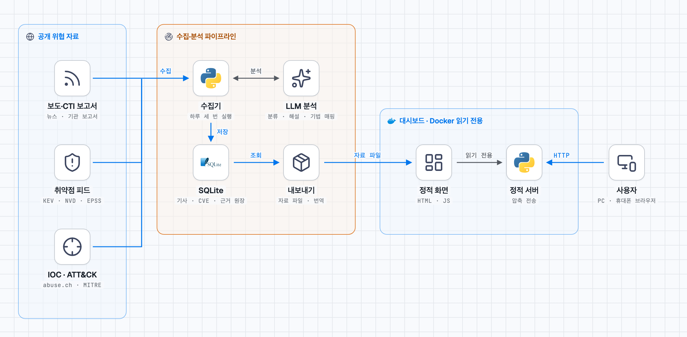
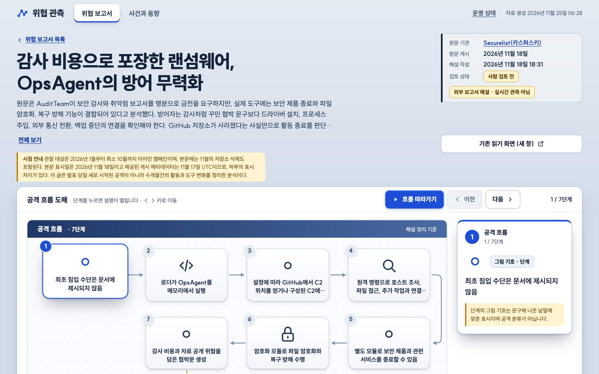
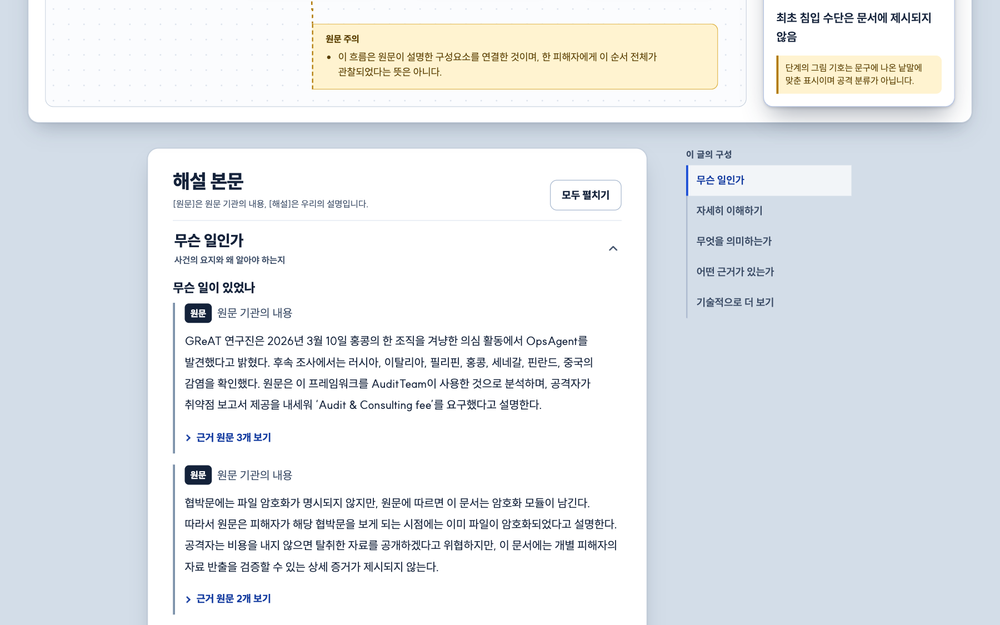
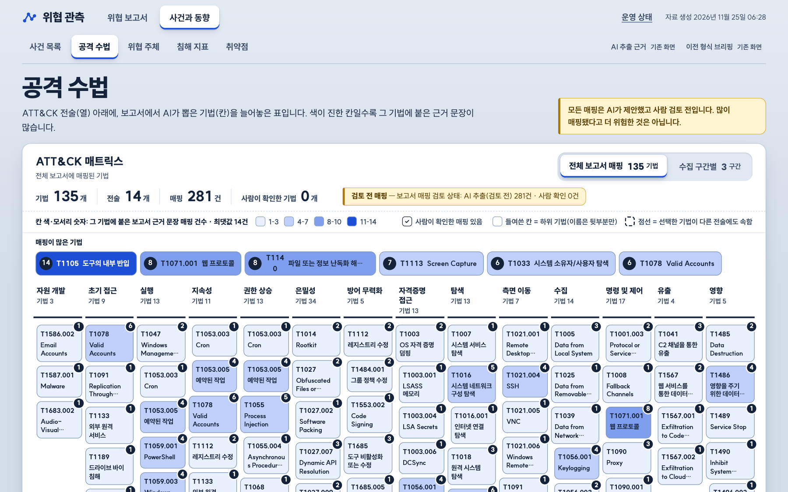
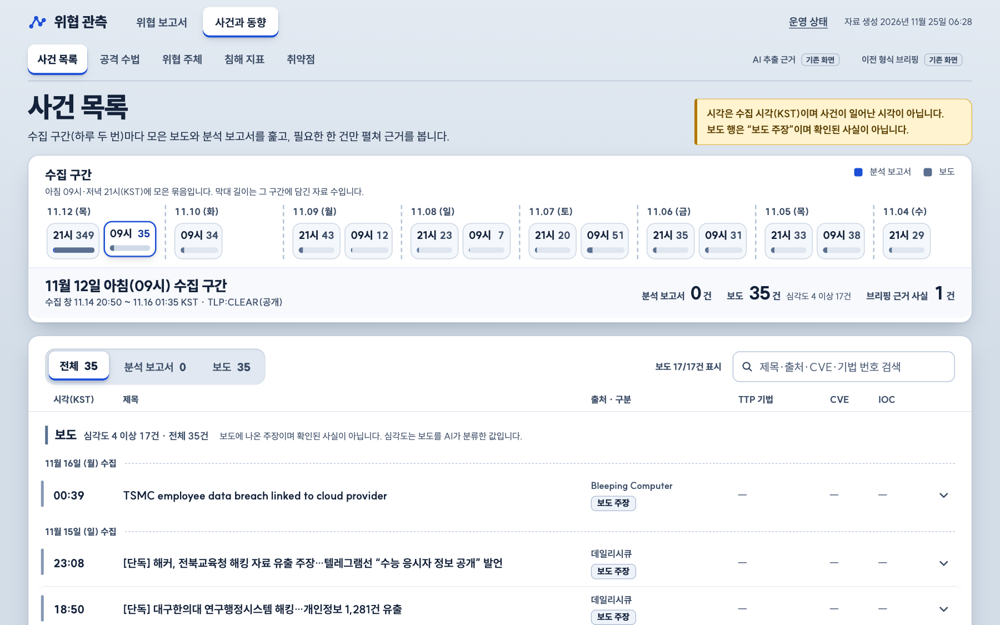

# 위협 관측 — 보안 학습자를 위한 CTI 대시보드

> 프로젝트 소개용 공개 사본입니다. 소스 코드·AI 지시문·수집 자료·자산 정보는 비공개 저장소에서 관리합니다.

공개된 보안 자료를 하루 세 번 모아 AI로 분류하고, 외부 전문 기관의 조사 보고서를 초보자용 한국어 해설로 바꿔 보여 주는 개인용 위협 인텔리전스(CTI) 대시보드입니다. **무슨 일이 일어났고 왜 중요한지, 그 판단이 어떤 근거에 기대고 있는지**를 한 화면에서 읽을 수 있게 만들었습니다.

| 항목 | 내용 |
|---|---|
| 문제 | 전문 CTI 보고서는 길고 어려워 처음 공부하는 사람이 읽기 힘들다. AI로 요약하면 쉬워지지만, 추정이 사실처럼 보이고 원문에 없는 내용이 섞일 위험이 있다 |
| 접근 | AI가 해설·공격 흐름·기법 매핑을 만들되, 모든 문장에 원문 근거를 붙이고 근거가 확인되지 않는 주장은 버린다. 화면은 사실·보도 주장·AI 추정을 라벨로 나눠 보여 준다 |
| 환경 | 맥미니 한 대, Docker, 사설망(Tailscale) 안에서 PC·휴대폰으로 접속 |
| 규모 | 수집·분석 계층 Python 약 8,400줄, 화면 JavaScript 약 8,900줄·CSS 약 2,200줄, 자동 시험 약 900개 |
| 기간·방식 | 2026-08 ~ 현재, 1인 개발. 설계 결정은 사람이 하고 구현에는 AI 코딩 에이전트를 활용 |

## 주요 기능

- **외부 보고서 해설**: Securelist·ESET 같은 전문 기관 보고서를 단계별 공격 흐름 도해와 쉬운 해설로 바꿉니다. 문단마다 근거 원문을 펼쳐 볼 수 있습니다.
- **사건 목록**: 하루 두 번의 수집 구간마다 분석 보고서와 보안 보도를 한 표에 모으고, 같은 사건을 다룬 기사는 한 행으로 묶습니다.
- **공격 수법(ATT&CK)**: 보고서에서 뽑은 기법을 MITRE ATT&CK 전술별 히트맵으로 보여 주고, AI 제안과 사람이 확인한 매핑을 구분합니다.
- **위협 주체**: 최근 7일과 직전 7일의 언급 수를 비교하고 MITRE 프로필을 함께 보여 줍니다.
- **침해 지표**: 외부 피드 등재값과 기사에서 자동으로 뽑은 값을 나눠 보여 주고, CSV·STIX 2.1·ATT&CK Navigator 레이어로 내려받습니다.
- **내 자산 취약점**: 내 장비·패키지와 일치하는 CVE 중 조치가 필요한 것만 첫 화면에 올립니다.

## 동작 구조

<picture>
  <source media="(prefers-color-scheme: dark)" srcset="images/00-flow-dark.png">
  
</picture>

공개 위협 자료(보도·전문 기관 보고서, 취약점 피드, 지표 피드, ATT&CK)를 하루 세 번 모아 AI로 분류·해설하고 저장합니다. 저장된 결과는 **읽기 전용 자료 파일 하나**로 내보내고, 빌드 과정이 없는 정적 화면이 이 파일만 읽어 모든 페이지를 그립니다. 수집기와 화면은 서로 다른 저장소에 있고, 둘 사이의 약속은 자료 형식 하나뿐입니다.

## 차별점

1. **AI가 낸 인용이 원문에 없으면 그 주장은 버립니다.** 해설의 모든 문단에 근거 원문이 붙고, 화면에서 바로 펼쳐 확인할 수 있습니다.
2. **사실·주장·추정을 섞지 않습니다.** 원문 기관의 관측, 언론 보도의 주장, AI 추출, 사람 확인에 서로 다른 라벨을 붙이고, 외부 보고서 해설에는 "실시간 관측 아님"을 표시합니다.
3. **합산 위험 점수를 만들지 않습니다.** KEV·EPSS·SSVC·CVSS는 서로 다른 질문에 답하는 값이라 나란히 보여 줍니다. 없는 값은 0이 아니라 `—`로 씁니다.
4. **시각을 섞지 않습니다.** 원문 게시일, 해설 작성일, 관측 기간, 수집 시각을 따로 두어, 몇 달 이어진 활동을 "이번 주 사건"으로 잘못 읽지 않게 합니다.

## 지킨 운영 원칙

인터넷 비공개(사설망 주소에만 게시) · 컨테이너 읽기 전용·최소 권한 · 외부 문자열은 글자로만 넣고 HTML로 해석하지 않음 · 분석·추적 스크립트 없음 · 색만으로 뜻을 전하지 않음(대비 4.5:1 이상)

## 화면

실제 운영 화면입니다. 개인 자산과 관련된 화면(내 자산 취약점)은 싣지 않았습니다.

| 보고서 상세와 공격 흐름 도해 | 해설 본문과 근거 원문 |
|---|---|
|  |  |
| 공격 과정을 단계로 정리해 그리고, "흐름 따라가기"로 단계별 설명을 차례로 엽니다. | `[원문]`과 `[해설]`을 나눠 쓰고, 문단마다 인용 위치를 펼쳐 봅니다. |
| **공격 수법(ATT&CK 매트릭스)** | **사건 목록** |
|  |  |
| 매핑이 많다고 더 위험한 것은 아니라는 점을 함께 밝힙니다. | 보도 행은 "보도 주장"으로 표시합니다. |

## 기술 스택

HTML · CSS · 바닐라 JavaScript(프레임워크·번들러 없음) · Python · SQLite · LLM · Docker · Tailscale · CISA KEV · NVD · FIRST EPSS · MITRE ATT&CK · SSVC · STIX 2.1

## 현재 상태

개인 프로젝트로 매일 운영 중입니다. AI 매핑에 대한 사람 검토 결과를 저장하는 기능, 주간 동향 보고서, 자산 범위 확대(Homebrew·npm·Docker 이미지 등)는 아직 계획 단계입니다.
